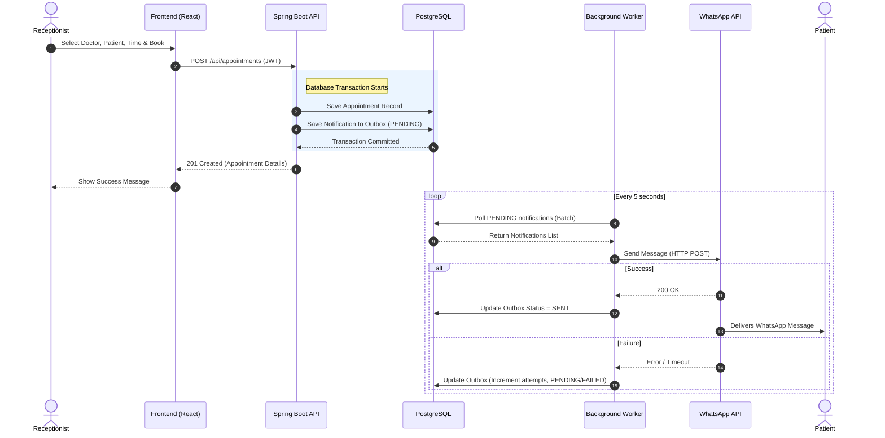
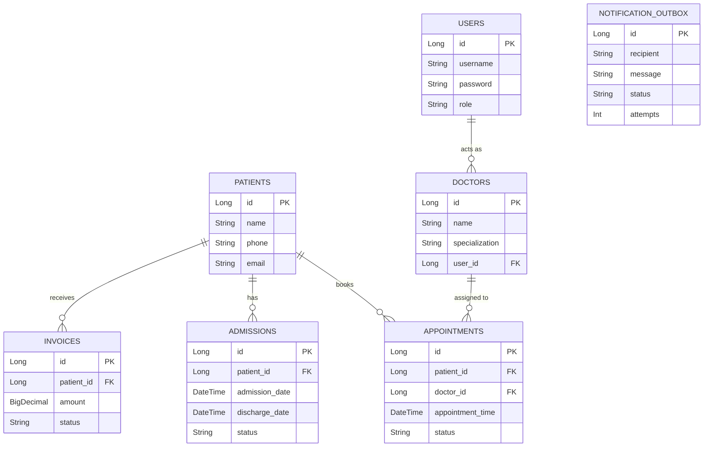
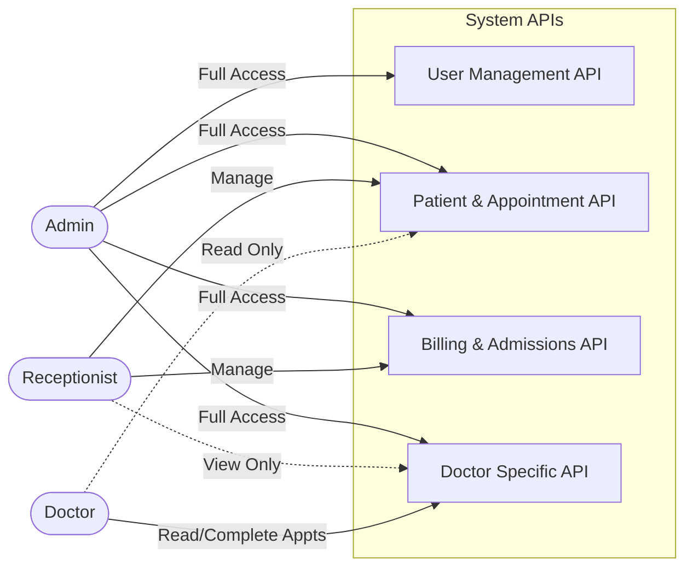

# Hospital Management System - Flow Diagrams

Here are complete flow diagrams that you can use for your college project documentation. These diagrams use [Mermaid.js](https://mermaid.js.org/) syntax, which is natively supported by GitHub, GitLab, and many Markdown editors (like Notion or Obsidian). 

You can either screenshot the rendered diagrams below or copy the code blocks directly into your project file if it supports Mermaid.

## 1. High-Level System Architecture Flow

This diagram illustrates how different users interact with the system, how the frontend communicates with the backend, and how external services (like Google OAuth and WhatsApp) are integrated.

```mermaid
flowchart TD
    %% Actors
    Admin([Admin])
    Receptionist([Receptionist])
    Doctor([Doctor])
    Patient([Patient / User])

    %% Frontend
    subgraph Frontend [Frontend (React + Vite)]
        WebUI[Web Application Interface]
    end

    %% External Identity
    GoogleOAuth[Google OAuth Provider]

    %% Backend
    subgraph Backend [Backend (Spring Boot 3)]
        Security[Spring Security + JWT Filter]
        
        subgraph Services [Business Logic & Modules]
            AuthService[Auth Management]
            PatientService[Patient Management]
            DoctorService[Doctor Management]
            ApptService[Appointment Scheduling]
            AdmissionService[Admission & Discharge]
            BillingService[Billing & Invoices]
        end
        
        subgraph Notifications [Asynchronous Notification System]
            OutboxWriter[Outbox Writer]
            OutboxPoller[Background Worker Poller]
        end
        
        Security --> Services
        ApptService --> OutboxWriter
        OutboxPoller -.-> OutboxWriter
    end

    %% External Services
    WhatsApp[WhatsApp / Twilio API]

    %% Database
    subgraph DatabaseLayer [PostgreSQL Database]
        DB[(HMS Relational DB)]
        OutboxTable[(Notification Outbox Table)]
    end

    %% Connections
    Admin --> WebUI
    Receptionist --> WebUI
    Doctor --> WebUI
    Patient -.-> WebUI
    
    WebUI -- "1. Login (Google)" --> GoogleOAuth
    GoogleOAuth -- "2. OAuth Code" --> WebUI
    WebUI -- "3. REST API Requests (JWT Bearer)" --> Security
    
    Services <--> DB
    OutboxWriter --> OutboxTable
    OutboxPoller <--> OutboxTable
    
    OutboxPoller -- "Webhook / HTTP POST" --> WhatsApp
    WhatsApp -- "Sends SMS/Message" --> Patient
```

---

## 2. Appointment Booking & Notification Sequence

This sequence diagram explains the exact chronological flow of what happens when a receptionist books an appointment, emphasizing the transactional outbox pattern used to ensure notifications are sent reliably.



---

## 3. Core Entity-Relationship Diagram (ERD)

This diagram highlights the relational database structure, showing how tables connect with each other.



---

## 4. Role-Based Access Control (RBAC) Flow

This diagram shows what different actors are authorized to do within the system.


