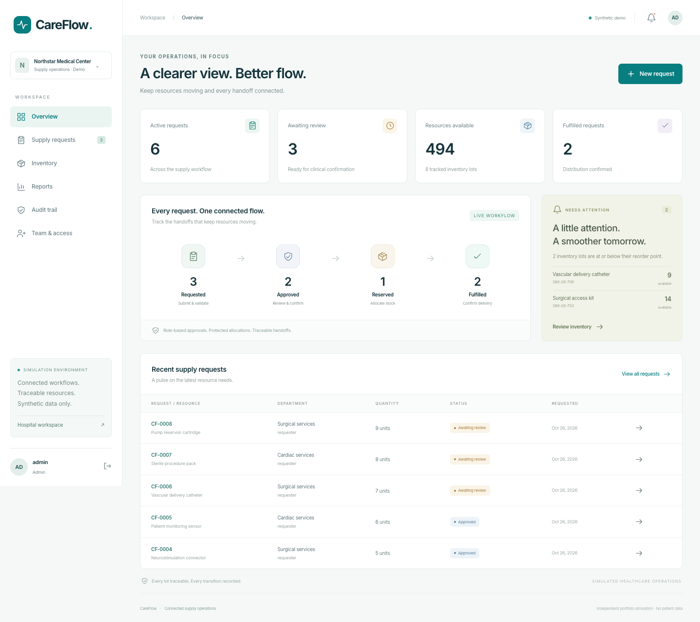
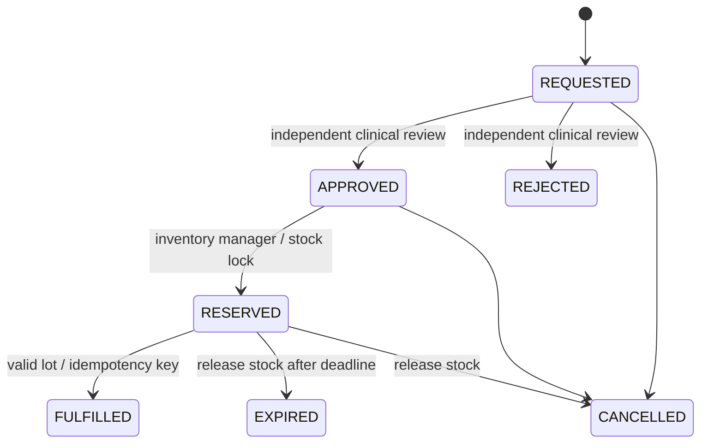

# CareFlow

A healthcare supply operations simulator built **on top of** [anshuBuilds/Hospital-Mangement-System](https://github.com/anshuBuilds/Hospital-Mangement-System). CareFlow adds transactional device inventory, clinical approvals, reservations, idempotent fulfillment, and persistent workflow audits to the existing hospital application.

Java 21 · Spring Boot · Spring Security/JWT · Spring Data JPA · PostgreSQL · React · JUnit 5 · Mockito · Testcontainers · Docker

Source repository: [giaphoang/careflow](https://github.com/giaphoang/careflow).



The portfolio focus is relevant to medical technology operations: synthetic device identifiers, lot traceability, expiry safeguards, quality holds, and verification evidence. This is an independent project, not a Medtronic product or an implementation of Medtronic's internal requirements. It contains no patient information and makes no diagnosis, treatment, or clinical prioritization decisions.

## Start the demonstration

From this directory, with Docker running:

```sh
docker compose up --build
```

Open [CareFlow](http://localhost:5173). The API runs at [localhost:8080](http://localhost:8080); interactive API documentation is at [Swagger UI](http://localhost:8080/swagger-ui/index.html). Compose enables synthetic demo seeding and simulated notifications. No external notification account is required.

| Role | Username | Password |
| --- | --- | --- |
| Administrator | `admin` | `admin123` |
| Requester | `requester` | `CareFlow@123` |
| Clinical staff | `clinical` | `CareFlow@123` |
| Inventory manager | `inventory` | `CareFlow@123` |

The sign-in page fills these credentials when you choose a role. The administrator can perform staff operations but cannot review their own request. Use the separate accounts to demonstrate separation of duties. Existing doctor and receptionist demo accounts remain available in the preserved [hospital workspace](http://localhost:5173/hospital).

### Without Docker

Prerequisites: JDK 21+, Maven 3.9+, Node.js 20+, and PostgreSQL 16+. Create a development database first. In separate terminals:

```sh
export DB_URL=jdbc:postgresql://localhost:5432/careflow
export DB_USERNAME=careflow
export DB_PASSWORD=your_local_password
export CAREFLOW_DEMO_ENABLED=true
mvn spring-boot:run
```

```sh
cd frontend
npm ci
npm run dev
```

Vite proxies API calls to port 8080. Set `VITE_PROXY_TARGET` if the backend uses another address. Backend defaults still follow the upstream PostgreSQL port of 5433; set `DB_URL` explicitly when using a database on 5432.

## Try the workflow

1. Sign in as **requester**, choose **New request**, select a usable lot, and submit a quantity and operational purpose. Submission validates the lot but does not promise stock.
2. Sign in as **clinical**, open the request from **Supply requests**, and record an approval or rejection with a reason. Approval does not reserve inventory.
3. Sign in as **inventory**, open an approved request, and reserve it. The default reservation lasts 30 minutes.
4. Confirm fulfillment. A stored idempotency key makes a retried operation return its original receipt, consuming stock once.
5. Open request history or the administrator's **Audit trail** to inspect actors, states, and timestamps. Inventory managers can adjust stock or place a lot on quality hold with a recorded reason.

The dashboard also provides inventory search, status filters, CSV export, request history, live operational reports, and administrator role assignment using the foundation's user-management APIs. Figures reflect loaded database records, not invented performance metrics.

## What was reused and added

The base repository was cloned with Git at commit `fcd3ebc9ae4e0b6a082af1fe4a19990357eb82b1`, retaining its history and its source remote as `upstream`. Its original documentation is preserved in [UPSTREAM_README.md](UPSTREAM_README.md).

| Reused foundation | CareFlow extension |
| --- | --- |
| Spring controllers, service/repository layers | Additive `com.example.hms.careflow` module and 12 routes |
| JWT login, refresh, logout, BCrypt, current database roles | Requester, clinical staff, and inventory manager roles; request ownership rules |
| PostgreSQL/JPA | Flyway-managed inventory, requests, fulfillment receipts, and audits |
| Transactional notification outbox and simulated channel | Low-stock and fulfillment events committed with business changes |
| React/Vite, authentication context, API helpers | Supply dashboard, device inventory, workflow forms, reports, and audit views |
| Patients, doctors, appointments, admissions, billing | Preserved at `/hospital` |
| Existing authentication and notification tests | 90 CareFlow unit executions, 24 shared integration scenarios, 2 PostgreSQL stress tests, a legacy-schema upgrade test, 6 browser tests |

The supporting [divyansh224/hospital-management-system](https://github.com/divyansh224/hospital-management-system) was reviewed as a service-layer validation/testing reference. Its MySQL application was not merged into the PostgreSQL foundation. See [provenance](docs/PROVENANCE.md) for boundaries and attribution.

## Transactional safeguards



Each operation holds the request row lock before acquiring the inventory row lock. PostgreSQL serializes competing allocations to a lot. `available = total − reserved`; fulfillment reduces both total and reserved. Cancellation and expiry release reserved stock without consuming it. Database checks enforce nonnegative stock and `reserved <= total`. Version columns provide an additional guard against stale writes.

Fulfillment receipts have globally unique keys and unique request IDs. Same-key retries on one request return the stored receipt. A key used for another request, a new key on an already fulfilled request, or a uniqueness race produces a conflict and rolls back. Request state, inventory, receipt, audit, and outbox changes share one transaction.

Expired lots (including their expiry date) and quality-held lots cannot be reserved or fulfilled. Existing reservations can still be cancelled or expired to release stock. A scheduled job checks expired reservations every minute, in batches of 100; row locks and transition checks make competing workers safe.

## Verification

```sh
mvn test
mvn -Ppostgres-tests verify
```

The second command requires Docker and starts PostgreSQL through Testcontainers. The test Docker client uses API `1.40`, configured in `src/test/resources/docker-java.properties`, to meet the GitHub runner daemon's minimum supported version.

To use an **isolated, disposable test database** instead:

```sh
CF_TEST_DATABASE_URL=jdbc:postgresql://localhost:5432/careflow_test \
CF_TEST_DATABASE_USERNAME=careflow \
CF_TEST_DATABASE_PASSWORD=your_test_password \
mvn -Ppostgres-tests verify
```

Integration tests clear the four CareFlow tables and the notification outbox in their configured test database before each test. Never point that setting at a database whose records you need to retain.

For browser checks, start the backend with demo mode enabled, then:

```sh
cd frontend
npm ci
npx playwright install chromium
npm run test:e2e
npm run build
```

The tests start Vite if needed. `CF_CHROME_PATH` can select an installed Chrome executable. The browser suite creates synthetic requests and exercises the full cross-role lifecycle. Java reports are in `target/surefire-reports` and `target/failsafe-reports`; browser reports are in `frontend/playwright-report`.

Run the synthetic processing comparison against a running demo:

```sh
node scripts/processing-benchmark.mjs
```

This creates dedicated synthetic benchmark lots and requests. `BENCHMARK_SAMPLES` defaults to 12 per variant; `MANUAL_STEP_MS` defaults to 100 ms per each of four handoffs. The baseline adds explicit simulated operator delay and repeated inventory/request lookups; the automated variant performs the four authorized writes directly. This is a reproducible simulation model, **not evidence of real hospital labor savings**. See [benchmark results](docs/BENCHMARKS.md).

[GitHub Actions](.github/workflows/careflow.yml) runs Java 21 tests, PostgreSQL/Testcontainers stress cases, the frontend build, browser workflows, and the processing benchmark, retaining reports for 30 days. Local verification evidence is documented separately; hosted run results are available in the repository's [Actions tab](https://github.com/giaphoang/careflow/actions).

## Documentation and deployment

- [12-route API reference](docs/API.md)
- [Requirements traceability](docs/TRACEABILITY.md)
- [Architecture and engineering tradeoffs](docs/ARCHITECTURE.md)
- [PostgreSQL schema migration](src/main/resources/db/migration/V1__careflow.sql)
- [Measured verification and benchmarks](docs/BENCHMARKS.md)
- [Deployment guide](docs/DEPLOYMENT.md)

CareFlow is packaged for Docker Compose. Public hosting is not provisioned by this repository. For a hosted deployment, configure PostgreSQL and the backend/frontend containers as described in the deployment guide. Disable demo seeding and configure a JWT secret and bootstrap administrator before exposing it beyond a private demonstration.
