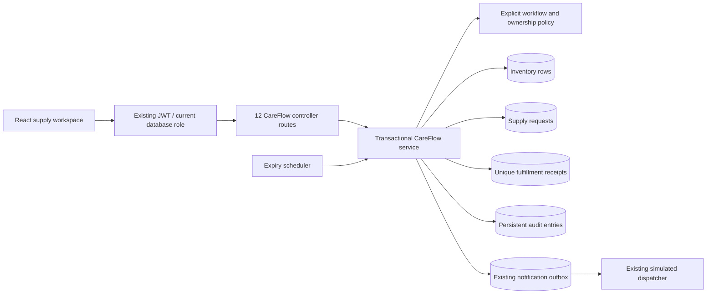

# Architecture and tradeoffs

CareFlow is an additive bounded module within the cloned hospital backend. It uses the existing authentication provider, user storage, token filter, exception envelope, and notification outbox. The original hospital controller paths and React dashboard remain available.

## Inventory and locking

`cf_inventory` tracks one UDI/lot/location record with total and reserved quantities; available is derived. Each request belongs to one lot, which keeps traceability and locking explicit. This version intentionally does not split one request across several lots or choose clinical priorities.

Services acquire a pessimistic write lock on the request before the inventory lot. Stock adjustments lock only the inventory row. This ordering avoids cross-operation request/inventory lock inversion. PostgreSQL's default READ COMMITTED isolation is sufficient because writes inspect the stock under a held row lock. Competing allocations wait and re-evaluate the updated stock. `@Version` fields and database stock bounds provide additional protection. No process-local mutex is used.

Pessimistic locking trades per-lot throughput for predictable safety and simple rollback. The tests use 32 application workers and the default bounded Hikari pool; 1,000 operations are queued through that pool, not 1,000 simultaneous database connections. Stress timings exclude scenario setup, HTTP transport, authentication, and JVM startup. They verify consistency, not an advertised production throughput capacity.

## Idempotency and rollback

Fulfillment locks the request, looks up the global key, and either returns the original immutable receipt or validates the RESERVED state. It checks deadline and lot quality/expiry before decrementing stock. A unique key and unique request ID prevent duplicate receipts even in cross-request key races. A uniqueness violation rolls back and becomes an HTTP conflict; the client may then retry with the correct request/key.

All business writes and outbox insertion participate in the same Spring transaction. An outbox insertion failure rolls back the inventory decrement, request transition, receipt, and audit. The integration contract injects this failure explicitly. Delivery is asynchronous and can be retried by the inherited outbox. The inherited dispatcher is not upgraded to an exactly-once external delivery guarantee; business fulfillment consistency is independent of duplicate transport delivery.

## Authorization

JWT validation and current user-role loading come from the foundation. CareFlow additionally authorizes in services so another controller or scheduler cannot bypass domain checks. All careflow roles may read inventory. Requesters see only their own requests. Clinical staff confirm another user's need. Inventory managers allocate, distribute, adjust stock, and place quality holds. Administrators may manage roles through inherited APIs and read the global ledger. Nobody can self review, including administrators; no self-approval exception is enabled.

The UI hides actions unavailable to the current role, while the backend enforces them independently. A role changed in the database takes effect on subsequent backend requests; signing in again refreshes the UI's stored role. UI list searches/filtering aggregate the paginated API for this synthetic dataset. A larger deployment should move search and aggregate reports to indexed server queries.

## Persistence and operational limits

CareFlow tables are introduced by Flyway V1. V2 widens the upstream PostgreSQL `users_role_check` constraint so an existing hospital database can accept the three added roles. A PostgreSQL regression test creates a legacy users table in an isolated schema, runs both migrations, and verifies that its original administrator remains while a requester can be added. The existing foundation tables still use upstream Hibernate `ddl-auto: update`. This preserves the selected base but is a documented deployment tradeoff: migrate the full inherited schema to versioned migrations and validation before a real production rollout. Flyway baselines an existing unversioned hospital schema at version 0, then creates the additive CareFlow tables. The first CareFlow migration assumes those `cf_*` tables do not already exist. Custom role constraints with other names need an installation-specific migration.

Audit rows are append-only through application APIs and have non-updatable columns. This is not a tamper-evident compliance ledger: a database administrator can modify records. Usernames are stored as actor snapshots, not foreign keys, so records retain their original actor label. Synthetic UDI strings are not validated against a manufacturer or a device registry. Expiry blocks at the start of its UTC calendar date. Reservation expiry runs in 100-record batches every minute; overdue holds may remain until a subsequent batch, but fulfillment is blocked immediately at the deadline.

The application retains inherited OAuth and JWT behavior. A public deployment needs configured OAuth or a disabled provider, TLS, managed secrets, restricted database access, backup/restore, and a review of inherited components. The portfolio does not claim regulatory validation, clinical suitability, or Medtronic affiliation.
