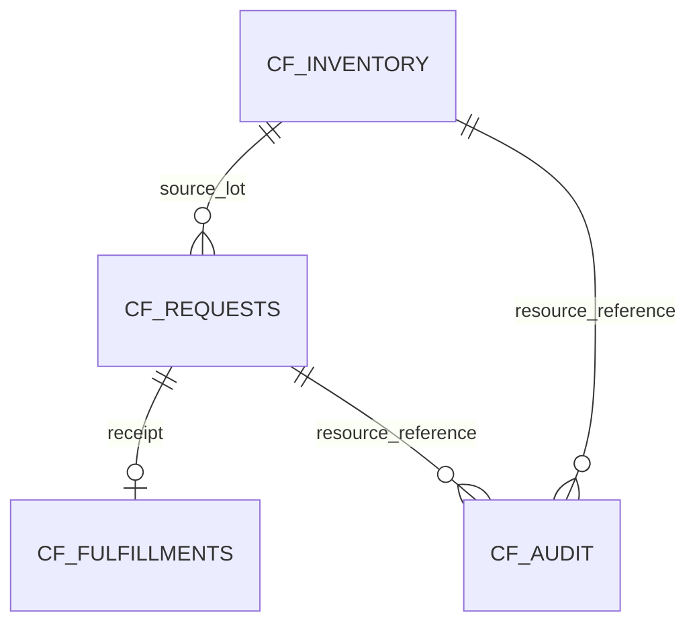

# Deployment

The supplied Compose stack builds Java 21 and React containers, starts PostgreSQL 16 with a health check, and serves the UI through nginx with same-origin API proxying. `docker compose config --quiet` validates its configuration. Local implementation was exercised with installed PostgreSQL and a Java/React server; Docker images were not built because the local Docker daemon was stopped.

```sh
docker compose up --build
```

The default ports are frontend 5173, API 8080, and PostgreSQL 5433 on the host. Override `FRONTEND_PORT`, `BACKEND_PORT`, and `POSTGRES_PORT` as needed. Persistent database records use the existing `hms_pg_data` volume. `docker compose down` stops the deployment and preserves that volume.

## Hosted/private demonstration

Run the same three components on a host/container service that supports a long-running JVM and PostgreSQL. Keep the frontend and API on one origin through the supplied nginx configuration, or configure CORS and `VITE_API_BASE_URL` explicitly. Set `APP_FRONTEND_URL` to the actual frontend origin.

For a private synthetic demo, enable `CAREFLOW_DEMO_ENABLED=true` and keep `NOTIFICATION_SIMULATION_ENABLED=true`. For a deployment beyond the demo, use `CAREFLOW_DEMO_ENABLED=false`, a strong `JWT_SECRET`, a private PostgreSQL connection, and non-default database credentials. On a fresh non-demo database, bootstrap an administrator through Spring's environment properties:

```sh
CAREFLOW_BOOTSTRAPADMIN_USERNAME=operations.admin \
CAREFLOW_BOOTSTRAPADMIN_PASSWORD=replace_with_a_unique_long_password \
CAREFLOW_DEMO_ENABLED=false \
DB_URL=jdbc:postgresql://database-host:5432/careflow \
DB_USERNAME=careflow \
DB_PASSWORD=your_database_password \
JWT_SECRET=replace_with_at_least_64_random_characters \
java -jar target/hospital-management-system-0.0.1-SNAPSHOT.jar
```

The bootstrap password must have at least 12 characters. Spring Boot relaxed binding maps these variables to `careflow.bootstrap-admin.username/password`. Remove bootstrap credentials from the runtime after the account exists. Existing demo accounts are not deleted when demo seeding is disabled; use a fresh database for non-demo deployment.

The administrator creates accounts through the inherited `POST /api/auth/users`, then assigns `REQUESTER`, `CLINICAL_STAFF`, or `INVENTORY_MANAGER`. The CareFlow Team & access screen updates existing roles. No public self-registration grants staff access.

Source is published to `https://github.com/giaphoang/careflow`. External application hosting is not provisioned. The local demo and Docker/CI definitions are reviewable artifacts; public application deployment requires the intended hosting destination and its credentials. The base repository's Cloud Run/Firebase instructions remain in `UPSTREAM_README.md` as a reference, but they describe the upstream project and must be adapted to this Java 21 extension.

## Database schema

The source of truth for the additive schema is `src/main/resources/db/migration/V1__careflow.sql`. V2 also upgrades the original `users_role_check` constraint on existing hospital databases:



Audit resource links are logical identifiers rather than foreign keys because inventory and requests share one ledger. The existing outbox stores simulated low-stock and fulfillment notifications. Flyway creates CareFlow tables before Hibernate initializes the preserved hospital schema.
